<div align="center">


<br /><br />

**Shipping production-ready web apps & intelligent systems.**<br />
<sub>Computer Science student building end-to-end products for real clients.</sub>

<br />

<a href="https://www.linkedin.com/in/maaz-n/"><code>LinkedIn</code></a> &nbsp;·&nbsp;
<a href="https://x.com/maaz_nm"><code>X / Twitter</code></a> &nbsp;·&nbsp;
<a href="mailto:justmaazkhan@gmail.com"><code>Get in touch</code></a>

</div>

<br />


## ~/about

```ts
const maaz = {
  role: "AI Systems & Full-Stack Engineer",
  focus: ["Next.js", "TypeScript", "AI Workflows", "Production Systems"],
  studying: "Computer Science",
  based: "Pakistan",
  backends: ["Neon", "Supabase", "Xata", "Appwrite"],
  status: "Open to remote roles",
} as const;
```

## ~/stack

<div align="center">
  
</div>

<br />

| Layer | Technologies |
| :--- | :--- |
| **Frontend** | `Next.js` `React` `TypeScript` `Tailwind CSS` `shadcn/ui` `Zustand` |
| **Backend & Data** | `Neon` `Supabase` `Xata` `Appwrite` `Drizzle ORM` `Better Auth` `Zod` |
| **AI & Tooling** | `Vercel AI SDK` `OpenAI / LLM APIs` `Git` `GitHub` `Vercel` |

## ~/projects

<table>
  <tr>
    <td colspan="2" valign="top">
      <h3>SmilePerks &nbsp;<sub><code>PRODUCTION</code></sub></h3>
      <p>A multi-clinic management platform built for a real client and live in production. Supports dentists, chiropractors, opticians, and other clinic types with dedicated admin, clinic, and patient dashboards, appointment and referral tracking, and a reward-claims engine.</p>
      <p>
        <code>Next.js</code> <code>TypeScript</code> <code>Supabase</code> <code>Tailwind CSS</code> <code>Zustand</code> <code>Zod</code>
      </p>
      <p>
        <a href="https://smileperkscanada.ca/">Live site ↗</a> &nbsp;&nbsp;·&nbsp;&nbsp; <sub>Private repository (client work)</sub>
      </p>
    </td>
  </tr>
  <tr>
    <td width="50%" valign="top">
      <h3>Huddle</h3>
      <p>A multi-workspace task management platform featuring server-enforced role-based access control (RBAC), structured review workflows, and real-time activity logging.</p>
      <p>
        <code>Next.js</code> <code>TypeScript</code> <code>Appwrite</code> <code>Tailwind CSS</code>
      </p>
      <p>
        <a href="https://teamhuddle.vercel.app/">Live demo ↗</a> &nbsp;&nbsp;·&nbsp;&nbsp; <a href="https://github.com/maaz-n/huddle">Source ↗</a>
      </p>
    </td>
    <td width="50%" valign="top">
      <h3>Scribly</h3>
      <p>A modern publishing and blogging platform engineered around a minimalist, distraction-free writing experience and fast edge delivery.</p>
      <p>
        <code>Next.js</code> <code>TypeScript</code> <code>Neon</code> <code>Drizzle</code>
      </p>
      <p>
        <a href="https://project-scribly.vercel.app/">Live demo ↗</a> &nbsp;&nbsp;·&nbsp;&nbsp; <a href="https://github.com/maaz-n/scribly">Source ↗</a>
      </p>
    </td>
  </tr>
</table>

## ~/activity

<div align="center">
  
</div>

<br />


<div align="center">
  <sub>Available for remote engineering opportunities &nbsp;·&nbsp; <a href="mailto:justmaazkhan@gmail.com">Get in touch</a></sub>
</div>
