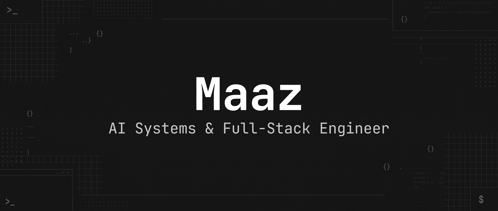

<div align="center">



<br />

**I build production-ready web apps with Next.js and TypeScript.**<br />
Computer Science student from Pakistan, shipping real products for real clients.

<br />

[**LinkedIn**](https://www.linkedin.com/in/maaz-n/)&nbsp;&nbsp;&nbsp;&nbsp;[**X**](https://x.com/maaz_nm)&nbsp;&nbsp;&nbsp;&nbsp;[**Email**](mailto:justmaazkhan@gmail.com)

</div>

<br />


## ~/about

```ts
const maaz = {
  role: "Full-stack developer",
  focus: ["Next.js", "TypeScript", "production-ready apps"],
  studying: "Computer Science",
  based: "Pakistan",
  backends: ["Neon", "Supabase", "Xata", "Appwrite"],
  lookingFor: "Remote roles",
} as const;
```

## ~/stack

<div align="center">
  
</div>

<br />

| Layer | Tools |
| :--- | :--- |
| **Frontend** | Next.js, React, TypeScript, Tailwind CSS, shadcn/ui, Zustand |
| **Backend and data** | Neon, Supabase, Xata, Appwrite, Drizzle, Better Auth, Zod |
| **Tooling** | Git, GitHub, Vercel |

## ~/projects

<table>
  <tr>
    <td colspan="2" valign="top">
      <h3>SmilePerks</h3>
      <p>A multi-clinic management platform built for a real client and live in production. It supports dentists, chiropractors, opticians, and other clinic types, with separate admin, clinic, and patient dashboards, appointment and referral management, and a reward-claims system.</p>
      <p><sub><code>Next.js</code> <code>TypeScript</code> <code>Supabase</code> <code>Tailwind CSS</code> <code>Zustand</code> <code>Zod</code></sub></p>
      <p><a href="https://smileperkscanada.ca/">Live site</a>&nbsp;&nbsp;&nbsp;<sub>Private repo (client work)</sub></p>
    </td>
  </tr>
  <tr>
    <td width="50%" valign="top">
      <h3>Huddle</h3>
      <p>A multi-workspace task management app with role-based permissions enforced on the server, a review workflow, and an activity log.</p>
      <p><sub><code>REPLACE</code> <code>WITH</code> <code>STACK</code></sub></p>
      <p><a href="https://teamhuddle.vercel.app/">Live demo</a>&nbsp;&nbsp;&nbsp;<a href="https://github.com/maaz-n/huddle">Source</a></p>
    </td>
    <td width="50%" valign="top">
      <h3>Scribly</h3>
      <p>A modern blogging app built around a clean, distraction-free writing experience.</p>
      <p><sub><code>REPLACE</code> <code>WITH</code> <code>STACK</code></sub></p>
      <p><a href="https://project-scribly.vercel.app/">Live demo</a>&nbsp;&nbsp;&nbsp;<a href="https://github.com/maaz-n/scribly">Source</a></p>
    </td>
  </tr>
</table>

<br />


<div align="center">
  <sub>Open to remote opportunities. <a href="mailto:justmaazkhan@gmail.com">Get in touch</a>.</sub>
</div>
